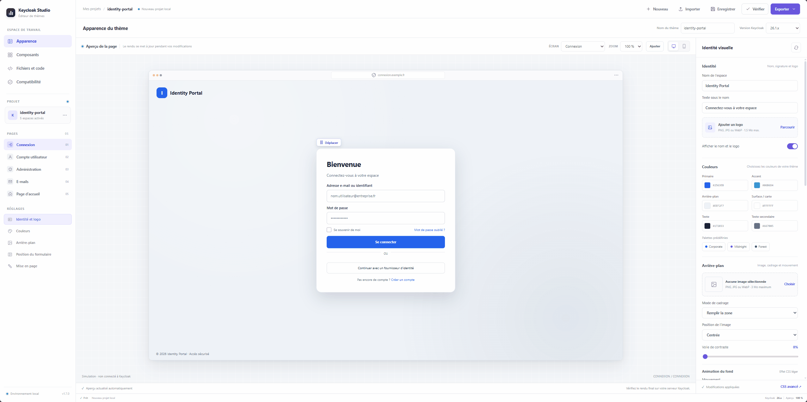
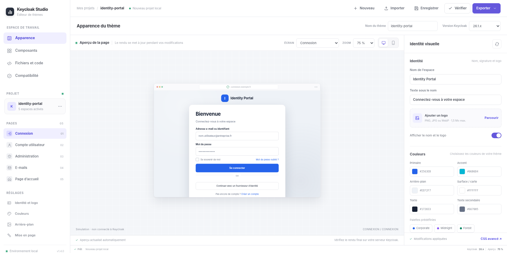

# Keycloak Theme Studio

**Keycloak Theme Studio** est une application web autonome pour concevoir, prévisualiser et générer des thèmes Keycloak. Le Studio combine un éditeur visuel, une prévisualisation de pages et un moteur de génération hybride : Keycloakify/React pour Login, génération native pour les autres types encore non pris en charge par ce moteur.

## Demo



> Version : `1.7.0` — positionnement libre du formulaire, intégration flexible et cadre entièrement facultatif



Aperçu mobile : [voir la capture](docs/screenshots/workspace-mobile-v1.4.0.png).

Exemple de formulaire positionné librement et sans cadre : [voir la capture](docs/screenshots/form-layout-v1.7.0.png).

## Interface et expérience d'utilisation

L'interface combine plusieurs conventions éprouvées : inspecteur et panneaux de propriétés des constructeurs web comme Webflow et Framer, canevas et gestion des ressources des outils de conception comme Penpot et Adobe XD, et accès aux fichiers inspiré des environnements de développement comme VS Code. Il ne s'agit pas de reproduire un produit particulier : la disposition est adaptée au travail spécifique sur les thèmes Keycloak. La sélection d'une page Keycloak dans la navigation gauche met à jour la prévisualisation. Les entrées de la zone « Réglages » amènent directement à la propriété correspondante dans l'inspecteur.

Le Studio utilise une interface claire, compacte et orientée travail, avec des conventions empruntées aux éditeurs visuels web, aux outils de conception graphique et aux environnements de développement. Les commandes de projet restent dans la barre supérieure ; les libellés marketing et les grands bandeaux de présentation ont été supprimés. L'aperçu reste une simulation locale et ne doit pas être confondu avec un test de rendu sur un serveur Keycloak.

## Fonctionnalités

Les commandes de création, gestion, import, édition, validation et export sont reliées au modèle de projet et aux API. Les modifications de conception sont synchronisées avec l’aperçu et le brouillon local.

- Création d'un projet vierge ou depuis une palette prédéfinie.
- Gestion des projets serveur : ouverture, duplication et suppression.
- Sauvegarde locale automatique du brouillon et sauvegarde explicite sur le volume Docker.
- Sélection des cinq types Keycloak : `login`, `account`, `admin`, `email`, `welcome`.
- Éditeur visuel : identité, logo, palette, typographie, largeur du formulaire, position, intégration et présentation du conteneur.
- Arrière-plan : import PNG/JPG/WebP (3 Mo max.), optimisation WebP, glisser-déposer dans le canevas, position, cadrage, voile de contraste et animations CSS (zoom lent, déplacement subtil, aurore).
- Respect de `prefers-reduced-motion` pour désactiver les animations lorsque le système le demande.
- Aperçu local simulé et isolé dans une iframe pour les cinq types, avec navigation de démonstration entre les écrans Login. Le canevas utilise l’espace disponible et démarre à 100 % ; un bouton permet de rétablir rapidement l’ajustement.
- CSS personnalisé et feuilles CSS de type affichés dans la prévisualisation.
- Aperçu desktop et mobile.
- Disposition du formulaire Login : position libre avec coordonnées X/Y en pourcentage, déplacement direct par glisser-déposer dans le canevas, positionnements prédéfinis, mode dans le flux et intégration dans un alignement à gauche ou à droite.
- Apparence du conteneur indépendante du formulaire : cadre activable/désactivable, fond et opacité, bordure, ombre, arrondis et espacement intérieur réglable même lorsque le cadre est retiré.
- Les options de disposition sont appliquées à la simulation, au CSS natif Keycloak et au CSS du projet React/Keycloakify. Les styles ciblent notamment les classes d’extension `kcLoginClass` et `kcFormCardClass` exposées par le template Keycloakify.
- Palettes prédéfinies : Corporate, Midnight et Forest.
- Mode expert : CSS additionnel et ajout de fichiers par type (CSS, JS, `.properties`, `.ftl`, etc.). Les feuilles sous `resources/css/` et scripts sous `resources/js/` sont automatiquement déclarés dans `theme.properties`.
- Choix de la version cible et modification des thèmes parents.
- Contrôle de structure et avertissements de compatibilité.
- Export ZIP pour le répertoire `themes/`.
- Export JAR natif historique avec `META-INF/keycloak-themes.json`, à déployer dans `providers/`.
- Moteur Login React construit avec **Keycloakify 11.16.4**, React et Vite, basé sur le starter officiel.
- Export direct d'un JAR Keycloakify depuis l'interface : le Studio compile les sources React, puis conserve les types Account, Admin, Email et Welcome sélectionnés en les assemblant depuis le générateur natif.
- Export des sources React / TypeScript / Vite, avec le JAR natif complémentaire lorsque d'autres types Keycloak sont sélectionnés.
- Contrôle de disponibilité de la chaîne Node.js / npm / Java / Maven avant l'export Keycloakify.
- Export natif ZIP/JAR conservé pour les thèmes existants et les templates FreeMarker Login personnalisés.
- Import/export du modèle de projet JSON.
- Import de thèmes Keycloak ZIP/JAR : détection des types, récupération des parents, fichiers texte et ressources binaires.
- Bibliothèque des ressources importées avec téléchargement et suppression.
- API REST documentée automatiquement par FastAPI.

## Position et présentation du formulaire

Dans **Apparence → Formulaire**, choisissez comment le formulaire s’intègre à la page :

- **Position libre** : placez le formulaire à l’aide des coordonnées horizontale et verticale (0 à 100 %) ou déplacez-le avec la poignée présente au-dessus du formulaire dans l’aperçu. Le déplacement enregistre automatiquement la position personnalisée.
- **Dans le flux** : le formulaire suit le flux de la page et reste centré, sans position absolue.
- **Aligné à gauche / à droite** : le formulaire est intégré dans une colonne de la page plutôt que superposé au fond.

La largeur est réglable de 240 à 1 200 px, dans la limite de l’espace disponible. Le cadre est entièrement facultatif : le préréglage **Sans cadre** retire le fond, la bordure, l’ombre et les arrondis. L’espacement intérieur reste indépendant et peut être conservé ou ramené à zéro. Cela permet d’obtenir un formulaire flottant, sans carte visible, tout en gardant le contenu lisible.

Keycloakify conserve son wrapper React nécessaire au rendu et au contexte des formulaires. Le mode sans cadre retire uniquement sa présentation visuelle ; il ne supprime pas les composants fonctionnels Keycloakify. Le même CSS de disposition est inclus dans l’export JAR Keycloakify et dans le générateur natif.

## Démarrage rapide avec Docker Compose

Prérequis : Docker Engine et le plugin Docker Compose. L'image installe Python, Node.js, npm, Java 21 et Maven afin de pouvoir compiler les thèmes Keycloakify directement côté serveur. Le JAR natif reste généré en Python sans dépendre de cette chaîne.

```bash
cp .env.example .env
docker compose up -d --build
```

Ouvrir ensuite : **http://localhost:8080**

Pour consulter l'état du service :

```bash
docker compose ps
docker compose logs -f keycloak-theme-studio
```

L'API interactive est disponible sur `http://localhost:8080/docs` et l'état de santé sur `http://localhost:8080/api/health`.

### Port et persistance

Le port hôte est réglé par `KTS_PORT` dans `.env` (8080 par défaut). Les projets enregistrés sur le serveur sont persistés dans le volume Docker `kts_projects`, monté sur `/data/projects`. Les dépendances npm et Maven téléchargées lors des compilations Keycloakify sont conservées dans `kts_keycloakify_cache`, monté sur `/data/keycloakify-cache`.

Pour les installations derrière un proxy d'entreprise, renseigner `HTTP_PROXY`, `HTTPS_PROXY` et `NO_PROXY` dans l'environnement du déploiement (ou dans `.env`). Ces variables sont transmises à npm et Maven au moment de la compilation. Ne pas inscrire de secrets de proxy dans le Dockerfile ni dans le dépôt Git.

Pour arrêter l'application sans supprimer les projets :

```bash
docker compose down
```

Pour supprimer aussi les projets persistés (opération destructive) :

```bash
docker compose down -v
```

## Déploiement du thème exporté

### ZIP

1. Exporter le thème au format ZIP.
2. Décompresser son contenu dans le répertoire `themes/` de Keycloak.
3. Vérifier que le résultat ressemble à `themes/<nom-du-theme>/login/theme.properties`.
4. Sélectionner le thème dans **Realm settings → Themes** pour les types disponibles.
5. Tester sur un realm et une instance non production avant tout déploiement.

### JAR natif

1. Dans **Exporter**, choisir **JAR natif**.
2. Copier le fichier dans le répertoire `providers/` de la distribution Keycloak.
3. Redémarrer Keycloak.
4. Sélectionner le thème dans **Realm settings → Themes**.

Cette voie ne nécessite ni Node.js, ni Java, ni Maven au moment de l'export côté application. Elle reste recommandée pour préserver sans adaptation les templates FreeMarker Login ajoutés dans le Studio.

### JAR React / Keycloakify

1. Reconstruire le conteneur Studio avec `docker compose up -d --build` afin d'installer Node.js, npm, Java et Maven.
2. Ouvrir **Exporter → JAR React · Keycloakify**. L'application vérifie la disponibilité des outils et lance automatiquement `npm install` puis `npm run build-keycloak-theme`.
3. Télécharger le JAR combiné : Login est construit en React avec Keycloakify ; les autres types sélectionnés sont conservés depuis le générateur natif du Studio.
4. Déployer le JAR dans `providers/`, redémarrer Keycloak et sélectionner le thème.

La première compilation télécharge les dépendances npm et les artefacts Maven ; les caches sont persistés dans `kts_keycloakify_cache`, ce qui accélère les exports suivants. Pour la matrice de versions, Keycloakify génère notamment un JAR pour Keycloak 11–21 et 26+, et un autre pour Keycloak 22–25. Le Studio sélectionne automatiquement l'archive adaptée à la version cible.

Le projet peut aussi être exporté comme **Projet React / Keycloakify** pour continuer le développement dans un IDE. Le ZIP contient les sources TypeScript/Vite, le CSS généré et un `native-sidecar.jar` natif complet. Ce dernier conserve aussi les personnalisations Login d'origine et sert de sauvegarde sans perte.

Le JAR Keycloakify est une voie de génération distincte du JAR natif ; il ne remplace pas ce dernier. Si un template `.ftl` personnalisé est présent dans `login/`, l'export Keycloakify est refusé avec une explication et le JAR natif reste disponible.

Les JAR Keycloak, qu'ils soient natifs ou Keycloakify, contiennent `META-INF/keycloak-themes.json` et des ressources sous `theme/<nom-du-theme>/...`.

## Exemples inclus

Le dossier `examples/` contient :

- `keycloak-theme-identity-portal.jar` et `.zip` : exports natifs construits par le générateur Studio ;
- `keycloakify-project-identity-portal.zip` : projet React / Vite fondé sur le starter officiel Keycloakify, avec un `native-sidecar.jar` complet ;
- `identity-portal.project.json` : modèle Studio d'exemple avec un template FreeMarker personnalisé (à exporter par le moteur natif) ;
- `identity-portal-keycloakify.project.json` : même thème sans remplacement FTL Login, utilisable avec le moteur React Keycloakify.

Le ZIP du projet React contient les sources, pas un JAR Keycloakify précompilé. Pour obtenir le JAR, lancer `npm install` puis `npm run build-keycloak-theme` dans le dossier extrait, ou utiliser directement **Exporter → JAR React · Keycloakify** dans le Studio.

## Versions Keycloak

Les parents par défaut sont définis selon la famille majeure choisie :

| Type | Keycloak 26.x | Keycloak 27.x |
|---|---|---|
| Login | `keycloak.v2` | `keycloak.v3` |
| Account | `keycloak.v3` | `keycloak.v3` |
| Admin | `keycloak.v2` | `keycloak.v2` |
| Email | `keycloak` | `keycloak` |
| Welcome | `keycloak` | `keycloak` |

Les valeurs restent modifiables dans **Compatibilité Keycloak**. Elles sont des valeurs de départ : vérifiez les thèmes réellement fournis dans votre build Keycloak, notamment pour les distributions dérivées et les versions correctives. Pour Login, le Studio utilise la propriété native `styles` et référence explicitement `css/login.css` puis `css/kts-overrides.css`, comme le recommande la documentation Keycloak lorsqu’une feuille enfant doit conserver celle du parent. Pour Account, Admin et Welcome, la feuille dédiée est déclarée comme ressource du thème.

Keycloak 27 fait évoluer le thème Login vers `keycloak.v3` et PatternFly 6. Le Studio adapte le parent Login par défaut à cette évolution.

## Limites connues

- L'aperçu est une simulation locale. Il n'exécute pas les vrais templates FreeMarker et ne se connecte pas à une instance Keycloak.
- Keycloakify est intégré comme moteur React pour Login dans cette version. Le thème Account, Admin, Email et Welcome reste fourni par le générateur natif, ce qui préserve la couverture des cinq types sans prétendre que Keycloakify les prend tous en charge. Keycloakify propose également des implémentations Account Single-Page et Multi-Page ; cette intégration spécifique n'est pas encore activée dans le Studio. La console Admin et Welcome ne sont pas générées en React par ce moteur.
- L'export JAR Keycloakify refuse les templates FreeMarker personnalisés sous `login/`, car ils peuvent entrer en conflit avec le rendu React. Utilisez le JAR natif pour les inclure sans perte.
- La compilation Keycloakify doit télécharger les dépendances npm et les artefacts Maven à la première utilisation. Un proxy d'entreprise doit être transmis au conteneur si les sorties Internet directes sont bloquées.
- Les templates FreeMarker ne sont pas générés automatiquement. Ils peuvent être ajoutés ou remplacés depuis le mode source.
- Pour les archives contenant plusieurs thèmes, le Studio importe le premier thème détecté et affiche les autres noms détectés. Le découpage multi-projets sera une évolution ultérieure.
- Les parents, classes CSS et ressources disponibles dépendent de la version exacte et de la distribution Keycloak.
- Le Studio vérifie la structure et les chemins. Elle ne remplace pas un test d'intégration sur le serveur Keycloak cible.

## Sécurité

- Les templates FreeMarker sont du code serveur. N'importez que des templates de confiance : un template malveillant peut exécuter du code avec les privilèges du processus Keycloak.
- Les fichiers sources personnalisés sont exportés tels quels. L'application ne les exécute pas.
- Le service tourne avec un utilisateur non privilégié, sans capabilities Linux, avec un système de fichiers racine en lecture seule et un volume dédié aux projets.
- Le reverse proxy TLS et l'authentification d'accès à l'interface sont à fournir par l'environnement de déploiement si l'application est exposée au-delà d'un réseau de confiance.
- Ne déployez pas directement un thème non audité en production.

## Tests

Dans un environnement Python, la persistance locale utilise `./data/projects` par défaut. La variable `KTS_DATA_DIR` permet de choisir un autre répertoire.

Dans un environnement Python :

```bash
python -m venv .venv
. .venv/bin/activate          # Windows : .venv\Scripts\activate
pip install -r requirements.txt
python -m unittest discover -s tests -v
```

## API principale

| Méthode | Route | Fonction |
|---|---|---|
| GET | `/api/health` | Santé du service |
| GET | `/api/defaults?version=26.1.4` | Parents par défaut et types |
| POST | `/api/validate` | Validation du projet |
| POST | `/api/import/archive` | Analyse et import d’un thème ZIP/JAR |
| POST | `/api/export/zip` | Génération ZIP |
| POST | `/api/export/jar` | Génération JAR natif historique |
| GET | `/api/keycloakify/status` | État des outils Node.js / Java / Maven |
| POST | `/api/export/keycloakify-project` | Projet React / TypeScript basé sur le starter Keycloakify |
| POST | `/api/export/keycloakify-jar` | Compilation Login React et assemblage du JAR hybride |
| GET | `/api/projects` | Liste des projets persistés |
| POST | `/api/projects` | Enregistrement d'un projet |
| GET | `/api/projects/{id}` | Chargement d'un projet |
| DELETE | `/api/projects/{id}` | Suppression d'un projet |

Le corps des routes de validation et d'export est `{ "project": { ... } }`. Le schéma de projet est conservé dans les fichiers JSON exportés depuis l'interface.

## Structure du dépôt

```text
keycloak-theme-studio/
├── app/
│   ├── main.py               # API FastAPI et générateur natif ZIP/JAR
│   ├── keycloakify_engine.py # Génération React/Vite, build JAR et fusion hybride
│   └── static/               # Interface web
├── docs/
├── examples/
├── tests/
├── Dockerfile
├── .dockerignore
├── docker-compose.yml
├── requirements.txt
└── README.md
```

## Licence

MIT — voir [`LICENSE`](LICENSE).

## Références techniques

- [Keycloak — Working with themes](https://www.keycloak.org/ui-customization/themes)
- [Keycloak — Localization](https://www.keycloak.org/ui-customization/localization)
- [Keycloakify](https://docs.keycloakify.dev/) — moteur React/TypeScript de génération des thèmes Login et JAR.
- [Starter officiel Keycloakify](https://github.com/keycloakify/keycloakify-starter) — structure React/Vite de référence.
